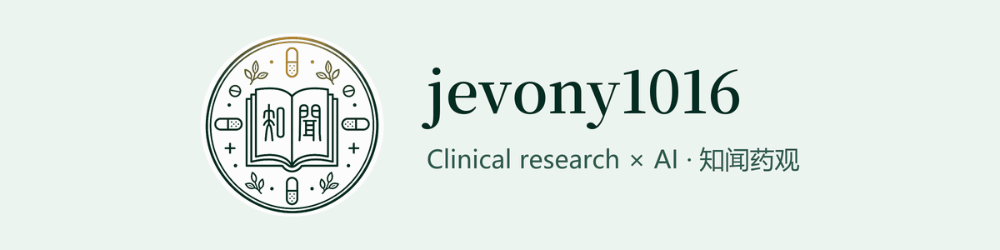

  

I work where clinical operations, applied AI and digital tools meet.

I spent about three years on the front line of global Phase III clinical trials (cardiovascular, renal and rare diseases), from CRA to Senior CRA. I now work on clinical AI and digital clinical operations.

> In clinical settings, traceability matters more than a fluent answer.

## 🔬 Research and study

- A peer-reviewed machine-learning study on clinical trial site risk prediction, published in the *International Journal of Medical Informatics* (2026).
- Studying technology transfer part-time (master's).

## 🧭 Interests

- Clinical AI
- AI governance and adoption
- Turning new technology into practical tools for clinical development
- First-principles thinking

## 🛠️ Projects

| Project | What it does |
| --- | --- |
| [**ferryman**](https://github.com/jevony1016/ferryman) | A ferryman, not a judge: a first-principles thinking skill for AI agents. Decisions, root causes, learning from the ground up, judging facts against rules; every answer traced to what it rests on and reviewed adversarially before you see it. Bonus clinical research pack (China GCP 2026, ICH, CTCAE, 21 CFR, EU CTR, verbatim). |
| [**zhiwen-yaoguan-toolkit**](https://github.com/jevony1016/zhiwen-yaoguan-toolkit) | 知闻药观工具箱：CTCAE v6.0 不良事件分级检索 (CTCAE v6.0 adverse event grading lookup). |

## ✍️ 知闻药观 (Zhiwen Yaoguan)

A Chinese WeChat official account on clinical-research regulation, AI in drug development, and AI work methods for people in pharma.

**读懂规则 · 看清技术 · 做出判断**

## Tools

## Contact

📫 [jevony1016@gmail.com](mailto:jevony1016@gmail.com)
